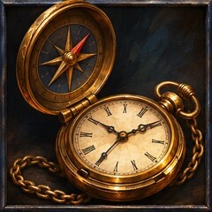
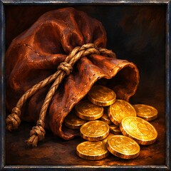
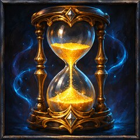
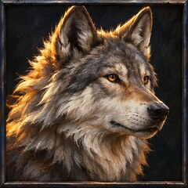
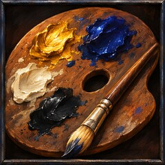
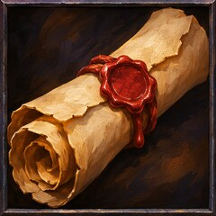

**A heads-up display for World of Warcraft: Forever, in one bar.** 
Your gold, bags, XP rate, gear and pet, live along the edge of your screen while you play.

     

Superb is a bar that runs along the top or bottom of your screen and keeps the numbers you care about up to date: what you're carrying, how fast you're levelling, how worn your gear is and how your pet is doing. The rest of your interface shifts over to make room, so nothing hides behind it. Glance at it mid-fight, hover an item for the full picture, right-click it for options. There is no settings window to learn.

<table>
<tr>
<td width="112"></td>
<td>

**The things you keep checking** 
The time, local or realm. Your zone and coordinates, your most worn piece of gear, your frame rate and latency. Click the clock for the calendar, or the zone for the map.

</td>
</tr>
<tr>
<td width="112"></td>
<td>

**Gold and bags** 
Your gold, what you made this session, and the total across your characters on the realm. Free bag slots, and what your bags would fetch: auction prices if you run AuctionDB, vendor prices if you don't.

</td>
</tr>
<tr>
<td width="112"></td>
<td>

**Levelling you can trust** 
XP per hour only counts the time you spend playing, so a cup of tea won't drag the number down. You also get time to level, time to your next milestone and a record of every level, and your session carries over a <code>/reload</code>.

</td>
</tr>
<tr>
<td width="112"></td>
<td>

**A happy pet** 
Hunters see their pet's mood, health and food on the bar. Left-click feeds it the right food from your bags, and right-click casts Mend Pet. Superb warns you when your pet turns unhappy or the food runs low.

</td>
</tr>
<tr>
<td width="112"></td>
<td>

**Yours to arrange** 
Five themes, from crisp light and dark to the game's own gold on dark. Hold <kbd>Shift</kbd> and drag any item to the left, centre or right of the bar, and switch off whatever you don't use.

</td>
</tr>
<tr>
<td width="112"></td>
<td>

**Quiet notifications** 
Small cards drop from the bar for new mail, full bags, worn gear, level-ups and your pet. They never make a sound, and each one goes away after a few seconds.

</td>
</tr>
</table>

More items are on the way. Want something on your bar? [Request a feature](https://github.com/adamkdean/superb/issues/new?labels=feature). Found a bug? [Report it](https://github.com/adamkdean/superb/issues/new?labels=bug).

## Install

> Superb is still in testing and has no release yet.

At release, Superb will be on CurseForge and Wago, so WowUp or the CurseForge app can install it and keep it up to date. To install it by hand:

1. Download Superb and unzip it.
2. Put the `Superb` folder in `World of Warcraft/_forever_/Interface/AddOns/`.
3. Start the game, or type `/reload` if it is already running.

The bar appears at the top of the screen. Click **Superb** at its left end for the menu.

## More

- [The guide](docs/GUIDE.md) covers every item, setting and command.
- [Developing Superb](docs/DEVELOPMENT.md) shows addon authors how to put their own items on the bar, and how to run the tests.

## Licence

[MIT](LICENSE). Copyright 2026 Adam K Dean.
